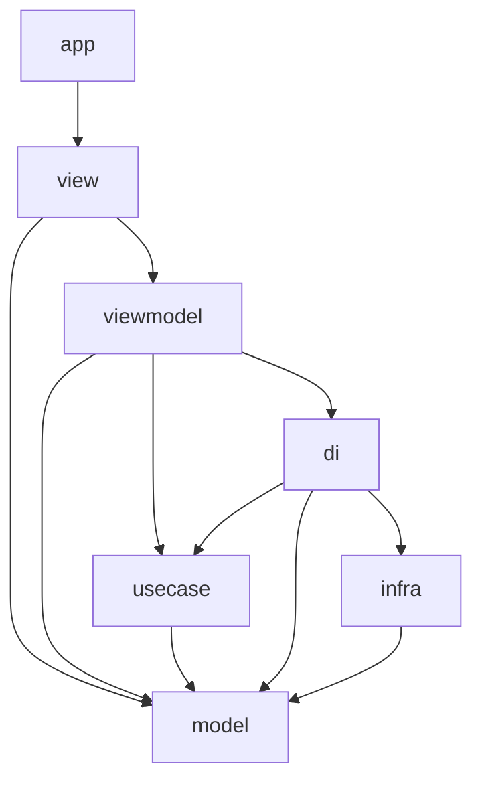
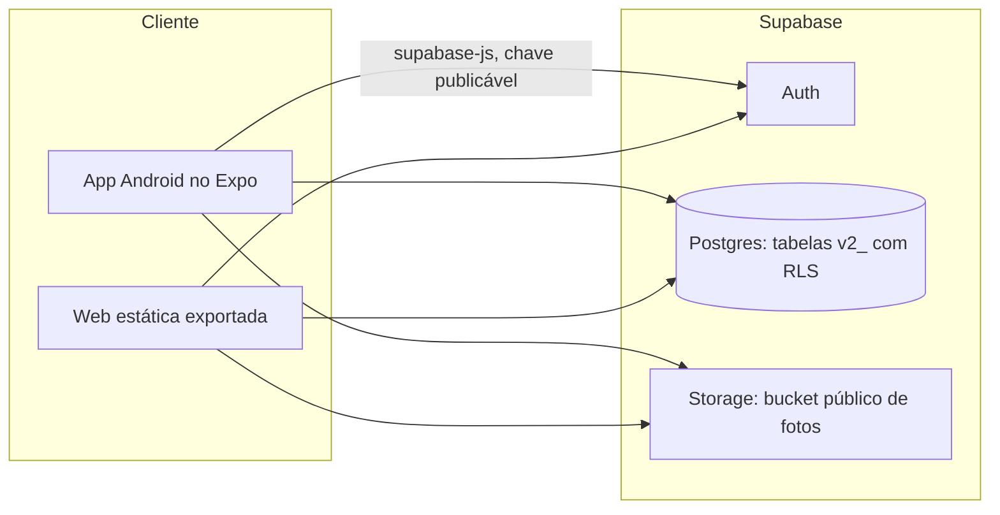
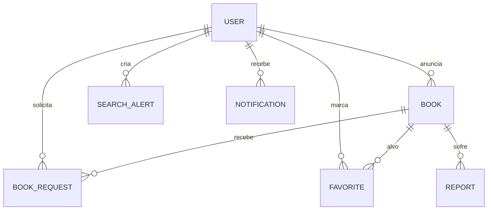

# Architecture Spine — IpêBook

## Design Paradigm

MVVM em sete camadas, com portas e adaptadores no limite de dados: os contratos `I*DataSource`
vivem em `model` e cada tecnologia concreta é um adaptador em `infra`.

| Camada | Diretório | Papel |
| --- | --- | --- |
| app | `src/app/` | Rotas do Expo Router; só reexporta View |
| view | `src/view/` | Renderização e captura de eventos |
| viewmodel | `src/viewmodel/` | Estado e ações da tela |
| usecase | `src/usecase/` | Operações e regras de negócio |
| model | `src/model/` | Entidades, contratos e erros puros |
| infra | `src/infra/` | Adaptadores de tecnologia |
| di | `src/di/` | Composição |

A direção de dependência não é convenção escrita: é o mapa `allowed` em
`scripts/verificar-arquitetura.mjs`, executado por `npm run check:architecture` e exigido por
`npm run validate`. Alterar a direção significa alterar esse mapa, no mesmo commit da
justificativa.

## Invariants & Rules



### AD-1 — MVVM em sete camadas com direção verificada [ADOPTED]

- **Binds:** todo código em `src/`
- **Prevents:** cada funcionalidade inventar a própria estratificação ou atalhar da tela ao banco
- **Rule:** nenhuma importação fora do mapa `allowed`; `npm run check:architecture` tem de passar sem violações

### AD-2 — `model` e `usecase` sem dependência externa [ADOPTED]

- **Binds:** `src/model/`, `src/usecase/`
- **Prevents:** regra de negócio presa a React, ao SDK do Supabase ou ao ambiente de execução
- **Rule:** nessas duas camadas só são permitidos imports relativos ou `@/`; o verificador falha em qualquer pacote externo

### AD-3 — Infraestrutura composta somente no container [ADOPTED]

- **Binds:** `src/di/container.ts` e todas as camadas acima
- **Prevents:** tela ou ViewModel acoplada a Supabase, impedindo teste sem rede
- **Rule:** só `di/container.ts` importa de `infra`; qualquer outra camada que importe falha na verificação

### AD-4 — Todo acesso a dados tem contrato e paridade de implementação

- **Binds:** `model/datasources/`, `infra/datasources/`, `supabase/migrations/`
- **Prevents:** funcionalidade que só existe em um backend. Já aconteceu: o adaptador Supabase de denúncia consultou `v2_reports` por dias sem que nenhuma migração a criasse (issue #79, corrigida em `202610170001_denuncias.sql`); o defeito ficou invisível enquanto o padrão era memória
- **Rule:** cada contrato `I*DataSource` tem implementação em memória e Supabase, e toda tabela que o adaptador Supabase referencia existe em uma migração do repositório; nenhuma entrega fecha com as duas em desacordo

### AD-5 — Mutação de outra entidade só por transição nomeada

- **Binds:** todos os casos de uso e contratos de datasource
- **Prevents:** dois donos da mesma entidade — risco imediato da issue #91, em que um `update(book)` genérico deixaria qualquer caso de uso alterar qualquer campo de um anúncio
- **Rule:** um caso de uso que precise mudar entidade de outro contexto usa um método de transição explícito e estreito no contrato (como `updateStatus`, que a negociação usa para reservar); contratos não expõem atualização genérica de entidade

### AD-6 — Autorização dupla: posse no caso de uso e RLS no banco [ADOPTED]

- **Binds:** todo caso de uso que lê ou grava dado de pessoa; toda migração
- **Prevents:** funcionalidade que confia só na interface (contornável) ou só no banco (sem mensagem de erro utilizável)
- **Rule:** a regra de posse é verificada no caso de uso (`ownerId === sessionUserId`, como em `cancelListing` e `deleteAlert`) **e** existe política RLS equivalente na tabela; teste cobre as duas

### AD-7 — Tabela nasce por migração, com prefixo e RLS

- **Binds:** `supabase/migrations/`
- **Prevents:** o par de defeitos das issues #79 e #80 — código apontando para tabela inexistente e histórico remoto divergente do repositório
- **Rule:** nome com prefixo `v2_`, `enable row level security` na criação, arquivo `YYYYMMDDNNNN_assunto.sql` versionado; nada é criado direto no painel ou por consulta solta, e `npm run test:sql` cobre a migração

### AD-8 — Seleção de backend única, com falha imediata

- **Binds:** `src/di/container.ts`, configuração de ambiente
- **Prevents:** metade do aplicativo em memória e metade no Supabase
- **Rule:** a escolha vem só de `EXPO_PUBLIC_BACKEND`, é resolvida uma vez na composição e falha na inicialização se a configuração estiver incompleta; nenhuma funcionalidade implementa fallback próprio. O padrão passou a ser `supabase` quando a issue #81 foi fechada; o modo em memória existe para teste e desenvolvimento, não como alternativa de produção

### AD-9 — Leitura do catálogo é anônima; escrita exige sessão

- **Binds:** `v2_books`, tudo que a Home, a Pesquisa e o detalhe exibem; todo caso de uso de escrita
- **Prevents:** funcionalidade que quebra para visitante anônimo (o primeiro contato com o aplicativo) e, no sentido oposto, escrita aceita sem sessão
- **Rule:** todo dado exibido no catálogo é legível pelo papel `anon` (a migração `202610150001` já concede `select` em `v2_books` a `anon`), e dado que exija sessão fica fora do catálogo em vez de escondido atrás de erro. Toda escrita passa por verificação de sessão no caso de uso (o `requireSession` já usado) e a política RLS correspondente concede escrita apenas a `authenticated` — conforme o ADR 0006, sem conta se vê o catálogo, não se anuncia nem se negocia

### AD-10 — Binário fora do banco, em bucket público com escrita do dono

- **Binds:** fotos de anúncio (issues #82 e #73) e qualquer arquivo futuro
- **Prevents:** uma funcionalidade escolher bucket privado e outra público, ou alguém gravar base64 em coluna de texto
- **Rule:** o binário vai para o Supabase Storage em bucket **público**, no caminho `ownerId/listingId/`, com escrita e remoção restritas ao dono por política em `storage.objects`; o modelo guarda apenas a referência. Bucket privado está descartado porque a leitura exigiria `createSignedUrl`, e não há servidor para gerar URL assinada a um visitante anônimo (ver AD-9). Nenhuma política de `select` ampla é criada nesse bucket: a leitura acontece pela URL pública do objeto, e conceder `select` em `storage.objects` abriria listagem e enumeração dos arquivos de todas as contas

### AD-11 — ViewModel é a única fonte de estado assíncrono [ADOPTED]

- **Binds:** `src/view/`, `src/viewmodel/`
- **Prevents:** cada tela inventar seu tratamento de carregamento e erro, e exceção vazando para a renderização
- **Rule:** carregando, erro e dados nascem no hook `use*ViewModel`; a View recebe estado pronto e não usa `try`/`catch`. A apresentação desses estados é padronizada pela spec 021 (issue #76), não reinventada por tela

### AD-12 — Padrão visual repetido nasce como componente

- **Binds:** `src/view/components/`, toda tela
- **Prevents:** a divergência já observável — o mapa de cor e rótulo da modalidade duplicado em cinco telas e `createListing.tsx` sem nenhum componente do design system (issues #90 e #92)
- **Rule:** elemento visual usado em mais de uma tela é componente em `view/components/`, com o documento correspondente em `design-system/04-componentes/`; tela nova compõe os existentes em vez de recriar estilo

### AD-13 — Leitura do catálogo é uma consulta por tela, filtrada no cliente [ADOPTED]

- **Binds:** Home, Pesquisa, favoritos e os filtros da issue #93
- **Prevents:** uma funcionalidade consultar o servidor por tecla enquanto outra filtra memória, duplicando a regra de correspondência em dois lugares
- **Rule:** a tela carrega o catálogo uma vez (`listBooks()`) e todo filtro, busca e ordenação opera sobre esse estado já carregado, como `useSearchViewModel` faz hoje. Vale enquanto o catálogo é de uma cidade; revisar quando passar de algumas centenas de anúncios ou quando a primeira carga ficar perceptível

### AD-14 — Exclusão de conta remove todo dado derivado

- **Binds:** `deleteAccount`, toda entidade e todo arquivo ligados a uma pessoa
- **Prevents:** dado remanescente após o exercício do direito ao esquecimento (LGPD, spec 014) — risco que cresce a cada entidade nova
- **Rule:** entidade ou arquivo novo declara, na sua especificação, o que acontece na exclusão da conta, e o caso de uso de exclusão é estendido no mesmo trabalho, com teste. Dado guardado só no dispositivo (como o histórico de buscas da issue #94) declara explicitamente que a exclusão alcança apenas o aparelho em uso — esse limite é dito na especificação e para a pessoa usuária, nunca apresentado como remoção completa

### AD-15 — Ícone só pelo `AppIcon` [ADOPTED]

- **Binds:** `src/view/`, `src/app/`
- **Prevents:** uma tela adotar Material e outra Fluent para o mesmo ícone, ou um ícone entrar com a cor nativa da biblioteca de origem em vez do token da marca
- **Rule:** nenhuma tela importa biblioteca de ícone direto; tudo passa por `view/components/AppIcon.tsx`, que resolve a biblioteca por plataforma conforme o ADR 0014 (SF Symbols no iOS, Fluent 2 na Web quando coberto, Material Symbols como alternativa) e aplica cor sempre a partir dos tokens. Ampliar a cobertura significa editar o mapa dentro do `AppIcon`, não importar na tela

### AD-16 — Visibilidade por status é decidida na leitura de dados

- **Binds:** `IBookDataSource.list`, `BookUseCases.listBooks`, Home, Pesquisa, filtros (issue #93), pausa de anúncio (issue #91)
- **Prevents:** a issue #91 esconder anúncio pausado no filtro do cliente enquanto a issue #93 reescreve esse mesmo filtro — a regra sobreviveria num lugar só e o anúncio pausado reapareceria
- **Rule:** quais status aparecem no catálogo é decidido na leitura (`listBooks`, hoje um repasse de `list()` sem filtro algum) e não no pipeline de filtro de AD-13; quem precisa do conjunto completo, como "Meus anúncios", pede por um método próprio e explícito

### AD-17 — Uma única regra de correspondência de termo

- **Binds:** busca (`useSearchViewModel`), alertas (`matchNewBook` em memória e o gatilho SQL), filtros (issue #93)
- **Prevents:** um termo casar na Pesquisa e nunca disparar o alerta equivalente. Já divergiu: a mesma regra existe em três lugares com normalização diferente — `toLowerCase()` em `useSearchViewModel.ts:19`, `toLocaleLowerCase("pt-BR")` em `memorySearchAlertDataSource.ts:31` e `position(lower(...))` no gatilho de `202610150003_favoritos_alertas.sql:70`
- **Rule:** a correspondência mora em uma função pura única em `model/`, usada pela busca, pelos filtros e pelo caminho em memória dos alertas; o gatilho SQL é a réplica declarada dessa regra e qualquer mudança altera os dois no mesmo commit, com teste que compare os dois caminhos

### AD-18 — Um único ponto de decisão da rota inicial

- **Binds:** `src/app/_layout.tsx`, boas-vindas (issue #98), estados de acesso (issue #97), gates de sessão das telas
- **Prevents:** dois redirecionamentos independentes na raiz disputando a primeira tela — por exemplo, alguém abrindo o aplicativo pela primeira vez através de um link de confirmação de e-mail
- **Rule:** a rota inicial é decidida em um só lugar, que recebe primeiro acesso e estado de sessão como entradas e define a precedência entre eles; tela nenhuma redireciona por conta própria na abertura. Os gates por tela continuam valendo apenas para proteger uma rota específica já alcançada

### AD-19 — Perfil próprio e perfil público são contratos distintos

- **Binds:** rota de perfil (issue #88), perfil público (issue #73), `usecase/`, `viewmodel/`
- **Prevents:** reaproveitar a ViewModel somente-leitura do perfil de terceiros para o perfil próprio, herdando a ausência de editar e sair — ou colidir uma rota estática `/perfil` com uma dinâmica `/perfil/[id]`
- **Rule:** perfil próprio e perfil de outra pessoa têm caso de uso, ViewModel e rota separados e nomeados (`/perfil` e `/usuario/[id]`); o perfil público nunca expõe e-mail nem dado de contato, e nenhum dos dois herda o contrato do outro

### AD-20 — Contrato de configuração igual nas duas plataformas

- **Binds:** variáveis `EXPO_PUBLIC_*`, `app.json`, build Android e exportação Web
- **Prevents:** Android e Web rodando com configurações incompatíveis — o caso concreto é a URL de retorno da recuperação de senha, que difere por plataforma (`ipebook://redefinir-senha` e a URL da Web) e, mal configurada, quebra o acesso só em uma delas
- **Rule:** toda configuração entra por variável `EXPO_PUBLIC_*` documentada em `.env.example`, é lida uma única vez na composição e validada na inicialização; valor que legitimamente difere entre plataformas é resolvido por `Platform` dentro de `infra`, nunca por configuração duplicada ou por ramo de código em camada acima

## Consistency Conventions

| Concern | Convention |
| --- | --- |
| Nomes | Entidades em inglês, singular (`Book`, `BookRequest`); arquivos e hooks em camelCase (`useHomeViewModel.ts`); contratos com prefixo `I`; rotas em português (`/meus-anuncios`); tabelas e colunas em snake_case com prefixo `v2_` |
| Dados e formatos | `id` é texto (uuid no Supabase); datas em ISO 8601; preço em número, obrigatório só na modalidade de venda; erros são subclasses de `DomainError` (`ValidationError`, `AuthError`, `DataSourceError`) com mensagem em português exibível |
| Estado e transversais | Sessão só pelo `AuthUseCases`; configuração só por variáveis `EXPO_PUBLIC_*`; nenhum dado pessoal em log; texto da interface em português; todo elemento interativo com rótulo acessível e alvo de 48 dp |

## Stack

| Name | Version |
| --- | --- |
| Expo | 57.0.23 |
| Expo Router | ~57.0.21 |
| React Native | 0.86.3 |
| React | 19.2.3 |
| react-native-web | ~0.21.0 |
| TypeScript | ~6.0.3 |
| @supabase/supabase-js | ^2.117.3 |
| Supabase CLI | ^2.120.0 |
| @react-native-async-storage/async-storage | 2.2.0 |
| Vitest | ^5.0.1 |
| @electric-sql/pglite | ^0.5.8 |

Versões lidas de `package.json` em 2026-10-17; o repositório é o dono delas. Expo, React, React
Native e `async-storage` estão em versão exata; as outras sete linhas usam faixa
(`^`/`~`), então o `package-lock.json` é o que fixa de verdade — nenhuma dessas linhas é garantia
de versão idêntica em outra máquina sem o lock. `pglite` existe para `npm run test:sql` executar
as migrações sem servidor. `async-storage` é usado apenas pela sessão do Supabase em
`infra/supabaseClient.ts`.

## Structural Seed





Todas as oito entidades têm tabela `v2_*` com RLS; `v2_reports` foi a última, em
`202610170001_denuncias.sql`.

```text
src/
  app/          # rotas Expo Router, em português
  view/
    components/ # design system aplicado
  viewmodel/
  usecase/
  model/
    entities/
    datasources/
  infra/
    datasources/
  di/
supabase/migrations/   # YYYYMMDDNNNN_assunto.sql
specs/                 # Spec Kit, uma pasta por funcionalidade
docs/adr/              # decisões arquiteturais
design-system/         # tokens, componentes e inventário de telas
```

## Capability → Architecture Map

| Área (issue) | Lives in | Governed by |
| --- | --- | --- |
| Fotos do anúncio (#82) | `model/entities/`, `infra/`, `view/listings/` | AD-10, AD-9, AD-14, AD-20 |
| Cidade única (#83) | `usecase/`, `model/` | AD-6, AD-9 |
| Rota de perfil (#88) | `app/`, `view/` | AD-19, AD-18, AD-1 |
| Diálogo de confirmação (#89) | `view/components/` | AD-12 |
| Tela de anunciar no design system (#90) | `view/listings/` | AD-12, AD-11, AD-15 |
| Editar e pausar anúncio (#91) | `usecase/`, `model/datasources/` | AD-5, AD-16, AD-6, AD-7 |
| Componentes faltantes (#92) | `view/components/` | AD-12, AD-15 |
| Filtros do catálogo (#93) | `viewmodel/`, `view/` | AD-13, AD-16, AD-17 |
| Histórico de buscas (#94) | `infra/` (local) | AD-14, AD-17 |
| Editar alerta (#95) | `usecase/`, `infra/datasources/` | AD-4, AD-5, AD-17 |
| Acessibilidade (#96) | `view/` | Conventions, AD-12 |
| Estados globais (#76) | `view/components/`, `viewmodel/` | AD-11 |
| Perfil público (#73) | `view/`, `usecase/` | AD-19, AD-6, AD-9 |
| Estados de acesso (#97) | `view/auth/`, `infra/` | AD-18, AD-20, AD-8 |
| Boas-vindas (#98) | `app/`, `view/` | AD-18, AD-9 |

As issues #79 (tabela de denúncia), #80 (histórico de migrações) e #81 (ativar o backend) foram
fechadas em 2026-10-17, enquanto este spine era escrito; AD-4, AD-7 e AD-8 passam a descrever o
que manter, não o que corrigir.

## Deferred

- **Serviço, limites e compressão das fotos:** o ADR da issue #82 decide formato aceito, tamanho
  máximo e se há redimensionamento no cliente. AD-10 fixa só onde o binário mora e quem escreve.
- **Campos editáveis de um anúncio e semântica de "pausado":** especificação da issue #91. AD-5
  fixa o formato da mutação, não a lista de campos.
- **Armazenamento do histórico de buscas:** issue #94. O dado é pessoal e não compartilhado, então
  o dispositivo é permitido; a decisão fica com a especificação.
- **Publicação, ambientes e monitoramento:** issue #87. Depende de domínio e conta que o usuário
  ainda não definiu; nenhum ambiente além do desenvolvimento local existe hoje.
- **Paginação e índice de busca:** fora de escopo enquanto AD-13 valer.
- **Mensageria entre pessoas:** não especificada e sem necessidade de produto declarada. O
  inventário do Figma prevê 22 telas no fluxo `06 · Conversa e negociação`
  (`design-system/telas-android-figma.md`) e a negociação hoje é atendida sem chat, por "Meus
  pedidos", "Pedidos recebidos" e o detalhe do encontro. O ADR 0011 tira "Conversas" da barra de
  navegação e diz explicitamente que **não** impede a funcionalidade no futuro — portanto chat
  continua em aberto como decisão de produto, não descartado. Se entrar, traz dimensões que
  nenhum AD cobre: tempo real, histórico de mensagem e moderação de conteúdo privado.
- **Modo escuro:** descartado pelo ADR 0008.
- **Login com Google:** o ADR 0006 o prevê como método de acesso e ele não existe no código
  (nenhum `signInWithOAuth`), nem tem issue aberta. Decidir se entra na beta — caso em que o
  fluxo de retorno do OAuth passa a ser mais uma dimensão de AD-8 — ou se o ADR 0006 é
  substituído por outro que registre a escolha de ficar só no e-mail.
