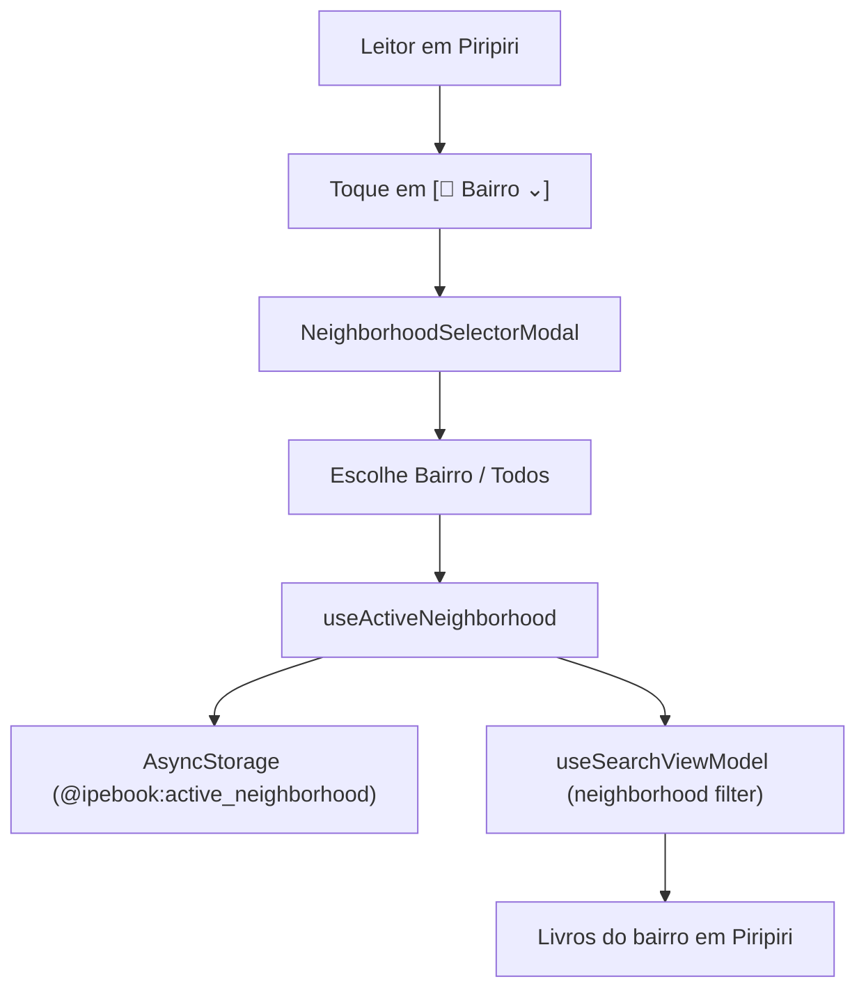

# Plano de Implementação — Spec 067: Seletor de Bairro e Filtro Territorial de Piripiri

## 1. Visão Geral e Arquitetura

O objetivo é fornecer um seletor acessível e persistente dos 17 bairros oficiais de Piripiri, PI (e a opção "Todos os bairros"), ligando o botão `[ 📍 Centro ⌄ ]` na Home e na Pesquisa à persistência no dispositivo e ao filtro do catálogo.

## 2. Componentes e Contratos

1. **`src/viewmodel/useActiveNeighborhood.ts`**:
   - `activeNeighborhood: string`: Bairro atualmente selecionado (ex: "Centro", "Petecas", "Paciência" ou "Todos os bairros");
   - `setActiveNeighborhood(neighborhood: string)`: Atualiza o estado e salva em `AsyncStorage` com chave `@ipebook:active_neighborhood`;
   - `isSelectorOpen: boolean`, `openSelector()`, `closeSelector()`.
2. **`src/view/components/NeighborhoodSelectorModal.tsx`**:
   - `visible: boolean`, `currentNeighborhood: string`, `onSelect: (neighborhood: string) => void`, `onClose: () => void`;
   - Campo de busca interno para filtrar a lista dos 17 bairros;
   - Renderização dos 17 bairros de `PIRIPIRI_NEIGHBORHOODS` + opção "Todos os bairros (Piripiri)";
   - Acessibilidade TalkBack/VoiceOver e toque 48dp mínimo.
3. **`src/viewmodel/useSearchViewModel.ts`**:
   - Estado: `neighborhood: string | "all"`;
   - Ações: `setNeighborhood: (neighborhood: string | "all") => void`;
   - `filteredBooks`: Filtra por `book.neighborhood` quando diferente de `"all"` e de `"Todos os bairros"`.
4. **`src/view/home.tsx` & `src/app/index.tsx`**:
   - Integração do seletor e do bairro ativo na pílula superior.
5. **`src/view/search/search.tsx` & `src/app/pesquisa.tsx`**:
   - Integração do seletor e do filtro de bairro na pílula superior e no catálogo de busca.

## 3. Estratégia de Testes (TDD)

- Passo 1: Escrever testes unitários para `useActiveNeighborhood` (carregamento inicial, persistência, alternância).
- Passo 2: Escrever testes unitários para `useSearchViewModel` validando o filtro por bairro.
- Passo 3: Escrever testes de componente para `NeighborhoodSelectorModal` (renderização, busca de bairro, seleção, acessibilidade).
- Passo 4: Implementar o código e verificar aprovação dos testes.
- Passo 5: Executar suite de regressão e validação (`npm run validate`, `npm run verify:release`).
